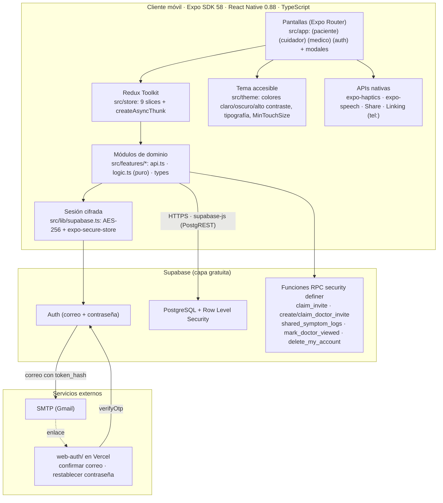
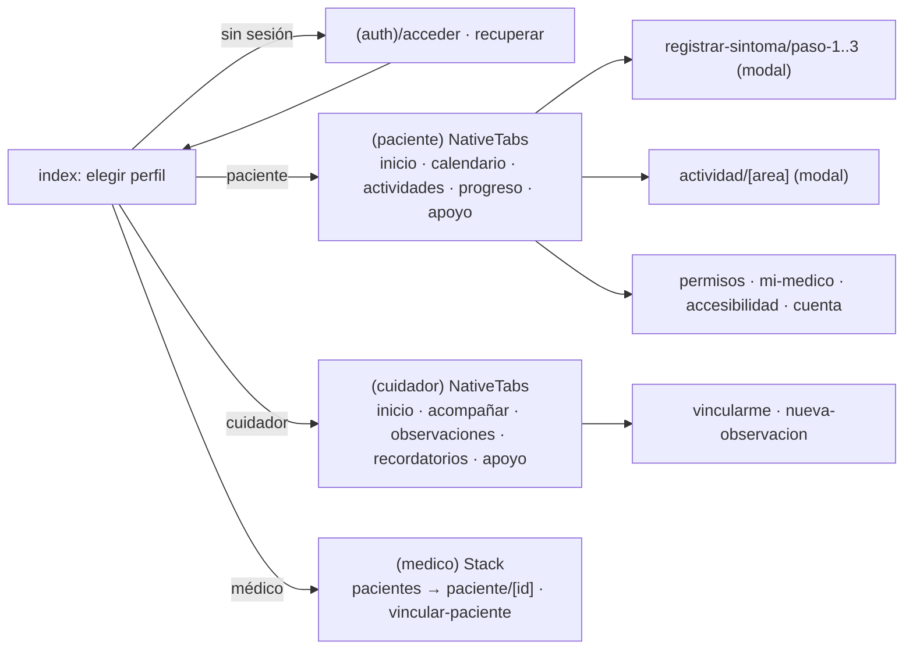
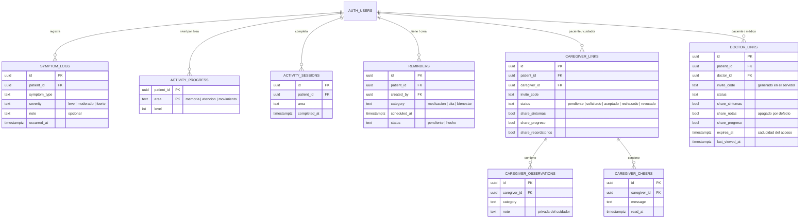
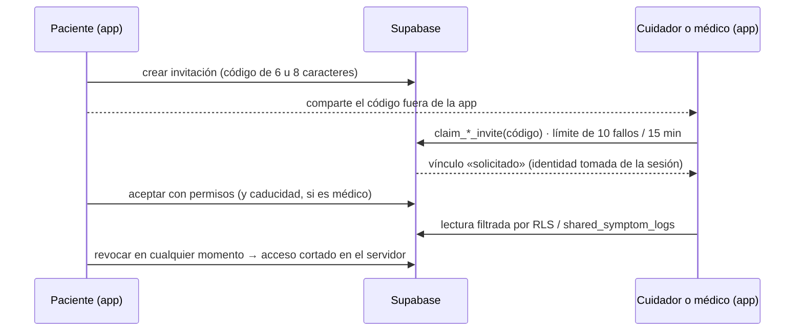

# Neurotrack EM — Documento Técnico Final (Fase 3)

**Una aplicación móvil para el seguimiento, la rehabilitación y el acompañamiento de personas con esclerosis múltiple**

| | |
|---|---|
| **Asignatura** | Desarrollo de Aplicaciones Móviles — Universidad de La Sabana, Facultad de Ingeniería |
| **Docente** | Santiago Rivadeneira Delgado |
| **Equipo** | Samuel Blanco · Amelyn Hofmann · Mariana Tirado |
| **Repositorio** | https://github.com/SamuelBlanco-65/NEUROTRACK_EM |
| **Fecha** | Noviembre de 2026 |

> Este documento consolida la propuesta del equipo (Fases 1 y 2, en `docs/enunciado/NEUROTRACK_EM - FUENTE DE VERDAD.pdf`,
> citada como «la propuesta» y por sección, p. ej. §IV-C) con el producto construido. Cada afirmación sobre el estado del
> software remite a un archivo del repositorio o a una evidencia en `artifacts/`. Lo que aún no tiene evidencia se marca
> como **sin verificar**; nada se presenta como verificado sin prueba o captura.

---

## Sección 1 · Visión del producto, problema y estado del arte

### 1.1 Resumen ejecutivo y propuesta de valor

**Nombre:** Neurotrack EM · **Tagline:** *«Tu evolución, tu proceso, tu camino.»*

**Propósito central.** Complementar —no reemplazar— el seguimiento médico de la esclerosis múltiple (EM) entre
consulta y consulta. La app permite al paciente registrar síntomas, hacer actividades de estimulación cognitiva y
motriz y ver su evolución, e integra a su cuidador y, de forma opcional, a su médico tratante, siempre con el
consentimiento del paciente.

**Propuesta de valor (UVP).** Un acompañamiento integral, simple y humano para el paciente y su entorno, que reúne en
un solo lugar síntomas, cognición, rehabilitación, apoyo emocional y cuidador, «sin quitarle el protagonismo al médico
tratante, sino dándole información útil que complemente su trabajo» (§IV-B). La app no diagnostica, no genera alertas
clínicas y no usa sensores (§IV-C).

**Usuarios y arquetipos de diseño.** Derivados de §I-C y de las necesidades de accesibilidad descritas en §V:

| Perfil | Necesidad principal | Necesidades de accesibilidad que condicionan el diseño |
|---|---|---|
| **Paciente con EM** (principal) | Registrar cómo se siente, mantener la estimulación cognitiva y motriz, ver su evolución y llevar información útil a la consulta | Fatiga cognitiva y física; alteraciones de memoria, atención y velocidad de procesamiento (presentes en ~41 % de los pacientes [1]); temblor y baja precisión motriz; neuritis óptica con secuelas de contraste, color y fotofobia; posible baja visión o ceguera |
| **Cuidador, familiar o pareja** (principal) | Acompañar sin invadir: saber cómo va la persona, anotar lo que observa, recordar medicación y citas | Carga de cuidado significativa [2]; uso en momentos cortos, con atención dividida |
| **Médico tratante** (opcional) | Ver un resumen y comparar el mes actual con los anteriores para detectar cambios que requieran atención (§I-C) | Lectura rápida, sin ruido; información que no se confunda con un diagnóstico |

### 1.2 Problema y análisis competitivo actualizado

La EM es una enfermedad neurodegenerativa muy variable: los síntomas (fatiga, dolor, alteraciones de movilidad y
visión, cambios cognitivos y emocionales) difieren de un paciente a otro, y los controles médicos no permiten un
monitoreo continuo (§II-A). Entre consultas, pacientes y cuidadores quedan sin acompañamiento, y los cuidadores notan
cambios que no saben cómo transmitir al médico. Las apps de salud móvil muestran beneficios pequeños a moderados en
cognición y fatiga, aunque la evidencia todavía es limitada [3].

**Tabla 1.** Competidores analizados en la Fase 1 (Cuadro I de la propuesta) y cómo responde el producto final.

| Herramienta | Qué hace | Brecha identificada (Fase 1) | Cómo la cubre Neurotrack EM (implementado) |
|---|---|---|---|
| **My MS Manager** (MSAA) | Registro de síntomas, reportes para el médico, recordatorios, noticias | Solo registro; sin rehabilitación ni espacio para el cuidador | Registro y calendario de síntomas **más** actividades de memoria, atención y movimiento, y módulo de cuidador con vínculo y permisos (RF-001..006) |
| **Floodlight MS** (Roche) | Pruebas funcionales con sensores (marcha, destreza, visión, cognición) | Casi puramente clínica; sin componente emocional ni rol de cuidador; desuso con el tiempo | Sin sensores (RT-003); tono de acompañamiento; espacio de apoyo con líneas de ayuda reales (RF-009) y cuidador activo |
| **MSCopilot** (Ad Scientiam) | Pruebas cortas con sensores; pensada como dispositivo médico | Demasiado texto, fatiga; casi no considera a la familia | Una acción principal por pantalla, instrucciones de una frase, actividades por pasos y sin cronómetro (RNF-008, RNF-010) |
| **MyTherapy** | Recordatorios de medicación y diario de síntomas | Entrenamiento genérico, no pensado para EM; sin perfil de cuidador ni apoyo psicológico | Recordatorios creados por el cuidador con alternativa visual y háptica (RF-008); contenidos de apoyo por perfil |
| *Brecha transversal* | Todas en inglés o francés, para sistemas de salud europeos o norteamericanos | — | Interfaz 100 % en español, con Línea 106 y Emergencias 123 de Colombia (RNF-011) |

### 1.3 Innovación lograda frente al estado del arte

1. **Tres perfiles en un ecosistema, con permisos controlados por el paciente.** Paciente, cuidador y médico comparten
   datos solo por vínculos que el paciente acepta y puede retirar; el control no está en la interfaz sino en la base de
   datos (Row Level Security de PostgreSQL). Ninguno de los competidores analizados combina los tres perfiles (§IV-B).
2. **Cuidador activo, no espectador.** Registra observaciones privadas, crea recordatorios, envía mensajes de ánimo y ve
   el progreso y los síntomas que el paciente autorizó (RF-006, RF-008, RF-012).
3. **Médico con información, no con alertas.** El perfil opcional compara el período actual con el anterior mediante
   diferencias neutras («3 días más que el mes anterior») e indica la constancia de registro, para que un día sin
   registro no se confunda con un día sin síntomas. Es de solo lectura y su acceso caduca (D-016).
4. **Estimulación sin presión.** Memoria y atención suben de nivel por precisión (2 de 3 rondas correctas), nunca por
   velocidad, siguiendo §V-B; movimiento sube al completar la sesión.
5. **Accesibilidad como requisito de dominio:** tipografía Atkinson Hyperlegible, escalado de texto con `lineHeight`
   escalado a mano, modo de bajo brillo, severidad codificada con forma y palabra, háptica, dictado y lectura en voz
   alta (Sección 3).

---

## Sección 2 · Arquitectura de software móvil e implementación técnica

### 2.1 Diagrama de arquitectura end-to-end



**Figura 1.** Topología de la solución. La app nunca usa la clave `service_role`: solo la clave pública, y la seguridad
la imponen las políticas RLS y las funciones del servidor.

### 2.2 Decisiones arquitectónicas y estructura de componentes

**Tabla 2.** Decisiones principales (detalle y alternativas en `docs/DECISIONES.md`).

| Decisión | Razón | Ref. |
|---|---|---|
| Expo + Expo Router (rutas por archivo) | Stack exigido; navegación declarativa por grupos de perfil | D-001 |
| Supabase (Auth + Postgres + RLS) en lugar de datos locales o Firebase | Sincronización real entre dispositivos (el enunciado prohíbe *mocks*) y un modelo de permisos por fila directo para «acceso con autorización» | D-002 |
| Redux Toolkit para estado global | Estado compartido entre pantallas (sesión, perfil, vínculos, borradores del asistente) y asincronía con `createAsyncThunk` | D-005 |
| Vinculación por código corto reclamable, no QR ni enlace profundo | Sin cámara ni deep linking; el reclamo lo hace una función del servidor que fija la identidad desde la sesión | D-010, D-016 |
| Correos con página estática y `token_hash` | El flujo PKCE con enlace a la app fallaba en otro dispositivo y en Expo Go | D-014 |
| Médico en tabla propia y de solo lectura | Las políticas del cuidador permiten escribir; un `role` compartido le habría dado esos permisos al médico | D-016 |

**Organización modular.** Cada módulo de `src/features/` separa tres capas: `api.ts` (acceso a Supabase y traducción
de errores a mensajes en español), `logic.ts` (reglas de dominio puras, sin React, con pruebas) y componentes propios.
Las pantallas (`src/app/`) no llaman a Supabase directamente: despachan *thunks* y leen del store.

| Módulo | Responsable en la defensa | Contenido |
|---|---|---|
| `auth`, `symptoms`, `legal`, `lib/supabase` | Samuel Blanco | Registro, acceso y recuperación; registro y calendario de síntomas; sesión cifrada |
| `caregiver`, `reminders`, `support` | Amelyn Hofmann | Vinculación y permisos, observaciones, mensajes, recordatorios, apoyo |
| `activities`, `progress` | Mariana Tirado | Memoria, atención y movimiento; períodos, agregación y tendencias |
| `doctor`, `audio`, `settings`, `profile` | Extensiones del equipo | Perfil médico, voz, preferencias de accesibilidad, perfiles |

**Flujo de navegación.** La primera pantalla (`src/app/index.tsx`) es un *radiogroup* de tres perfiles; sin sesión
redirige a `(auth)/acceder`, y con sesión al inicio del perfil (`src/features/profile/constants.ts`, `PROFILE_HOME`).



**Figura 2.** Navegación por perfil. Los grupos `(paciente)` y `(cuidador)` usan pestañas nativas (`NativeTabs`); el
médico usa una pila sin pestañas porque solo consulta.

**Manejo de estado asíncrono.** Cada llamada remota es un `createAsyncThunk` con estados `idle | cargando | listo |
error` que las pantallas traducen a `ScreenState` (carga, error o vacío). Dos detalles relevantes:

- Errores tipados por clase (`sin-conexion`, `servidor`, `validacion`, `codigo-invalido`): por ejemplo, un `TypeError` de
  red se muestra como «Revisa tu conexión e inténtalo de nuevo» (`src/features/*/api.ts`).
- Respuestas tardías: el resumen del médico guarda el `requestId` de la última petición y descarta respuestas de un
  período anterior (`src/store/slices/doctor-slice.ts`).

**Almacenamiento seguro de sesión.** `expo-secure-store` limita cada valor a ~2 KB en Android y el JWT de Supabase lo
supera; con el adaptador simple la sesión no sobrevivía a un reinicio. Se implementó el patrón `LargeSecureStore`: una
clave AES-256 aleatoria vive en SecureStore y la sesión cifrada en AsyncStorage (`src/lib/supabase.ts`). Las
preferencias de accesibilidad (no son datos de salud) se guardan sin cifrar en el dispositivo
(`src/features/settings/persistence.ts`). Al cerrar sesión, `resetAll` descarta de la memoria todos los datos de salud.

**Rendimiento.** Las listas de la app son acotadas (registros de un mes, tres áreas, pocos vínculos), por lo que se usa
`ScrollView` en lugar de listas virtualizadas. Los cálculos derivados (agregación por semana o mes, comparación de
períodos, calendario) son funciones puras memorizadas con `useMemo` (en 11 componentes) y se piden al servidor solo los
rangos necesarios (período actual y anterior). Una lista virtualizada (`FlatList`) queda en el *roadmap* si el
historial crece.

### 2.3 Modelo de datos y contratos de servicio



**Figura 3.** Esquema relacional (8 migraciones en `supabase/migrations/`). Todas las tablas referencian `auth.users`
con `on delete cascade`, así que eliminar la cuenta borra todos los datos (`delete_my_account`).

**Tabla 3.** Contratos de acceso (políticas RLS y funciones RPC).

| Recurso | Paciente | Cuidador (vínculo aceptado) | Médico (vínculo aceptado y vigente) |
|---|---|---|---|
| `symptom_logs` | Todo lo suyo | Solo vía `shared_symptom_logs`, sin notas, si `share_sintomas` | Solo vía `shared_symptom_logs`; notas solo si `share_notas` |
| `activity_progress`, `activity_sessions` | Todo lo suyo | Lectura si `share_progreso` | Lectura si `share_progreso` |
| `reminders` | Todo lo suyo | Crear y marcar «hecho» (un trigger impide editar otros campos) si `share_recordatorios` | — |
| `caregiver_observations` | **No las ve** | Las suyas | — |
| Vínculos | Crear invitación, aceptar, rechazar, revocar | Reclamar código (`claim_invite`) | Reclamar código (`claim_doctor_invite`); no puede modificar el vínculo |

**Flujos de datos principales.**

1. **Registrar un síntoma:** asistente de 3 pasos → borrador en `symptoms-slice` → `createSymptomLog` inserta en
   `symptom_logs` con el reloj del dispositivo → el calendario invalida el mes y lo vuelve a pedir.
2. **Vincular a un cuidador o médico** (la invitación del médico la crea el servidor; el código del cuidador lo genera
   el cliente con aleatoriedad criptográfica):



**Figura 4.** Vinculación con consentimiento explícito (RF-012, REC-003).

---

## Sección 3 · Implementación y auditoría de accesibilidad móvil

La propuesta de accesibilidad de la Fase 2 está en §V de la propuesta y se basa en WCAG 2.2 nivel AA [8] y en los
principios POUR. Su justificación es clínica: la neuritis óptica afecta hasta al 70 % de los pacientes y más del 80 %
presenta alguna disfunción visual (§V-D1); la alteración cognitiva está presente en ~41 % [1], [4], [7].

### 3.1 Semántica para lectores de pantalla (TalkBack)

- **Propiedades nativas en todos los controles:** el código usa `accessibilityRole` en 203 lugares,
  `accessibilityLabel` en 167, `accessibilityState` para seleccionado, marcado, deshabilitado u ocupado, y
  `accessibilityHint` cuando la acción no es obvia (conteo con `grep` sobre `src/`).
- **Roles con significado:** `radiogroup`/`radio` en la selección de perfil, severidad, duración del acceso y período;
  `switch` en los permisos; `header` en títulos de sección; `alert` en errores; `progressbar` en los niveles.
- **Agrupamiento para evitar focos fragmentados:** tarjetas y filas se declaran `accessible` con una etiqueta completa.
  Por ejemplo, cada permiso de «Mi médico» es un solo `Pressable` con `accessibilityRole="switch"`, y el `Switch` visual
  se oculta al lector (`importantForAccessibility="no-hide-descendants"`) para que no se anuncie dos veces
  (`src/app/mi-medico.tsx`).
- **Cambios dinámicos anunciados:** `accessibilityLiveRegion` en 33 lugares (estados de carga y error, errores de
  campos, cambio de período en Progreso y en el resumen del médico, código regenerado).
- **`testID`** estables en todos los controles interactivos (297), que se usaron en la verificación automatizada en
  emulador.

### 3.2 Diseño visual, contraste y tipografía adaptativa

- **Contraste:** los tokens (`src/theme/colors.ts`, paleta Material 3 del diseño en Stitch) se auditaron calculando la
  fórmula de WCAG sobre ~29 pares texto/fondo en ambos esquemas. Esa auditoría encontró y corrigió dos defectos reales:
  roles `onSecondaryFixed` usados sobre `secondaryContainer` (1,00–1,82:1 en oscuro) y texto `tertiary` sobre banners
  `tertiaryFixed` en oscuro.
- **`lineHeight` sin recorte:** React Native escala `fontSize` con la preferencia del sistema, pero no un `lineHeight`
  numérico fijo, lo que recortaba texto con fuente grande. `ThemedText` lo escala a mano:

```tsx
// src/components/themed-text.tsx (línea 20)
const scaledLineHeight = lineHeight ? lineHeight * appTextScale * PixelRatio.getFontScale() : undefined;
```

- **Tipografía:** Atkinson Hyperlegible Next, diseñada por el Braille Institute para baja visión, con jerarquía fija
  (28/24/20 para títulos y 19/17/15 para el cuerpo).
- **Nunca solo color (§V-D3):** la severidad se muestra con tres barras (llenas o con contorno, del mismo color) y la
  palabra «Leve/Moderado/Fuerte»; el resultado de las actividades usa ícono ✓/✕ y texto; los permisos muestran «Sí/No»
  además de la posición del interruptor; las comparaciones usan flechas y texto, sin rojo-verde.
- **Bajo brillo (§V-D4):** esquema oscuro sin blanco ni negro puros, y apariencia elegible en la app (claro, oscuro o
  automático), independiente del sistema. También hay alto contraste y «Reducir animaciones» (`src/app/accesibilidad.tsx`,
  `src/theme/index.ts`).

### 3.3 Ergonomía táctil y navegación

- **Área táctil:** `MinTouchSize = 48` dp en todos los botones; los íconos de 32 dp llevan `hitSlop={8}` (40 usos), y
  los botones principales miden 56 dp.
- **Sin gestos complejos ni tiempo límite:** todo se hace con toques simples. Memoria y atención no tienen cronómetro, y
  movimiento se marca paso a paso al ritmo de cada persona (§V-C).
- **Retroalimentación multicanal:** `expo-haptics` en Memoria, Atención, Movimiento y al marcar un recordatorio;
  mensajes visibles de éxito y error; `ActivityIndicator` y `accessibilityState={{ busy }}` durante la carga.

### 3.4 Matriz trazable: propuesta del Corte 2 frente a implementación final

**Tabla 4.** Cada mejora prometida en §V, dónde está implementada y cómo se validó. Estados: **V** = verificado con
prueba o captura; **C** = confirmado por auditoría de código, sin evidencia en dispositivo; **P** = pendiente.

| # | Mejora prometida (§) | Implementación (archivo) | Validación realizada | Estado |
|---|---|---|---|---|
| 1 | Alternativas visuales y hápticas a las alertas sonoras (§V-A) | `src/app/(paciente)/inicio.tsx` (recordatorio «hecho» con ✓ + háptica), `src/app/actividad/[area].tsx` | Usuario en emulador; captura `artifacts/t4/t4-nuevo-recordatorio.png` | V |
| 2 | Transcripción y subtítulos en contenido audiovisual (§V-A, RF-010) | `src/features/support/constants.ts`, `src/app/apoyo/[id].tsx` | Captura `artifacts/t5/paciente-apoyo-detalle-audio.png` | V |
| 3 | `accessibilityLiveRegion` para cambios dinámicos (§V-A) | `src/components/screen-state.tsx`, `text-field.tsx`, `(paciente)/progreso.tsx`, `(medico)/paciente/[id].tsx` | Auditoría `accessibility-reviewer` (2026-11-09 y 2026-11-11) | C |
| 4 | Instrucciones cortas, navegación consistente, pasos simples (§V-B) | Asistente `src/app/registrar-sintoma/paso-1..3.tsx`; `InstructionCard` en actividades | Capturas `artifacts/t1/wizard-paso*.png` | V |
| 5 | Dificultad progresiva sin que la velocidad sea el criterio (§V-B) | `src/features/activities/logic.ts` (sube con 2 de 3 rondas correctas) | 11 pruebas en `activities/__tests__/logic-test.ts` | V |
| 6 | Áreas táctiles amplias, sin gestos de precisión (§V-C) | `MinTouchSize` en `src/theme/spacing.ts`; `hitSlop` | Auditoría de código; 2 excepciones corregidas | C |
| 7 | Texto escalable sin recortes ni superposición (§V-D2) | `src/components/themed-text.tsx` (`lineHeight` escalado) | Auditoría (defecto encontrado y corregido) | C — falta captura con fuente ampliada |
| 8 | Un elemento principal por pantalla (§V-D2) | Patrón título + 1 acción + `ScreenState` en todas las pantallas | Auditoría de código | C |
| 9 | Estados con color + ícono + texto, sin rojo-verde (§V-D3) | Severidad en `(paciente)/calendario.tsx`, `features/doctor/severity-bars.tsx`; `FeedbackBadge`, `ShapeButton` | Captura `artifacts/t1/calendario-dia-con-registros.png` | V |
| 10 | Paleta validada contra protanopia, deuteranopia y tritanopia (§V-D3) | `src/theme/colors.ts` | Simulación hecha sobre la paleta v2 propuesta, **no** sobre la paleta final de Stitch | P |
| 11 | Modo de bajo brillo, sin blanco puro sobre negro, sin destellos (§V-D4) | `DarkColors` en `src/theme/colors.ts`; apariencia en `src/app/accesibilidad.tsx` | Auditoría de contraste; el usuario probó el modo oscuro en emulador (2026-11-09) | C — ver limitación 5.2 |
| 12 | Contraste y brillo de la app disociados del sistema (§V-D4) | Preferencia de apariencia y alto contraste persistida (`features/settings/persistence.ts`) | Revisión de código | C |
| 13 | Navegable con lector de pantalla, etiquetas en todo ícono y botón, orden lógico (§V-D5) | Propiedades `accessibility*` en `src/app/**` y `src/components/**` | Auditoría de código; primera pasada manual con TalkBack del usuario, sin documentar | C |
| 14 | Entrada por voz para el registro de síntomas (§V-D5) | `src/features/audio/dictation-button.tsx` en el paso 3 (micrófono del teclado) | Implementado; sin captura | C |
| 15 | Versión auditiva de las actividades (§V-D5, extensión) | `expo-speech` en `src/features/audio/` + interruptor «Lectura en voz alta» | 32 pruebas en `audio/__tests__`; usuario lo confirmó en su celular | C |
| 16 | `lineHeight` sin *clipping* y foco agrupado (requisito de la Fase 3) | `themed-text.tsx`; contenedores `accessible` | Auditoría de código | C |

---

## Sección 4 · Pruebas funcionales, rendimiento y validación de usuario

### 4.1 Pruebas automatizadas

108 pruebas con Jest (`jest-expo`) sobre la lógica de dominio, sin UI: 12 suites, todas en verde (`npm test`). Además
`tsc --noEmit` y ESLint (configuración `eslint-config-expo`) pasan sin errores.

| Suite | Pruebas | Qué cubre |
|---|---|---|
| `doctor/logic-test.ts` | 24 | Vigencia y caducidad del acceso; comparación por tipo de síntoma (días distintos, no registros); textos sin «mejor/peor/alerta»; constancia de registro; notas solo del período; texto compartido |
| `audio/scripts-test.ts`, `screen-scripts-test.ts`, `voice-test.ts` | 32 | Guiones de lectura en voz alta, partición de textos largos, selección de voz |
| `progress/logic-test.ts` | 14 | Rangos de semana, mes y 3 meses; agregación por grupo; tendencias; umbral de datos insuficientes |
| `activities/logic-test.ts` | 11 | Generación de rondas; verificación de respuestas; subida de nivel por precisión |
| `legal/legal-test.ts` | 7 | Contenido obligatorio de términos y privacidad; constancia de consentimiento |
| `symptoms/calendar-test.ts`, `summary-test.ts` | 9 | Cuadrícula del mes, peor severidad del día, días por tipo |
| `auth/validation-test.ts`, `deep-link-test.ts` | 8 | Validación de correo; lectura de enlaces |
| `about/content-test.ts` | 3 | La app declara que no diagnostica |

### 4.2 Casos de prueba ejecutados en dispositivo (flujos de negocio)

Ejecutados contra el backend real de Supabase, en emulador Android (automatizado con `adb` y `uiautomator` en T0–T1) o
en celular con Expo Go.

**Tabla 5.** Casos ejecutados y evidencia.

| # | Caso | Tipo | Resultado | Evidencia |
|---|---|---|---|---|
| 1 | Registro, aviso de confirmación pendiente e inicio de sesión | Happy path | OK | `artifacts/t05/t05-acceder-registro.png`, `t05-registro-exitoso-redirige-inicio.png` |
| 2 | Inicio de sesión con correo sin confirmar | Error | Mensaje traducido con ícono | `artifacts/t05/t05-acceder-error-correo-no-confirmado.png` |
| 3 | Validación de campos en el cliente | Error de validación | Borde, ícono y texto | `artifacts/t05/t05-acceder-validacion-cliente.png` |
| 4 | La sesión persiste tras reiniciar la app | Persistencia | OK (después de corregir SecureStore) | STATUS T0.5 |
| 5 | Registrar síntoma en 3 pasos, con y sin nota | Happy path | Aparece en el calendario | `artifacts/t1/wizard-paso1..3.png`, `calendario-dia-con-registros.png` |
| 6 | Actividades de Memoria, Atención y Movimiento hasta completar la sesión | Happy path | Sube de nivel; resumen | Confirmado por el usuario; capturas de versión anterior en `artifacts/t2/` |
| 7 | Progreso: semana, mes, 3 meses, gráfico y tabla | Happy path | Insights y datos insuficientes | `artifacts/t3/progreso-*.png` |
| 8 | Vínculo paciente–cuidador con dos cuentas | Happy path + permisos | El cuidador solo ve lo autorizado | `artifacts/t4/Inicio_cuidador.png`, `t4-acompar.png` |
| 9 | Observaciones privadas y recordatorio marcado «hecho» | Happy path | OK con háptica | `artifacts/t4/t4-observaciones.png`, `t4-recordatorios.png` |
| 10 | Apoyo: llamada a líneas de crisis y guía con transcripción | Happy path | OK en ambos perfiles | `artifacts/t5/*.png` |
| 11 | Confirmar correo y recuperar contraseña desde otro dispositivo | Happy path | OK | Confirmación verbal del usuario, sin captura |
| 12 | Perfil médico con dos cuentas: vincular, aceptar con permisos, resumen, revocar | Happy path + permisos | OK | Confirmación verbal del usuario; [PENDIENTE: capturas en `artifacts/t10/`] |
| 13 | Errores de red | Error | Mensaje «Revisa tu conexión» por clase de error | Revisión de código; sin captura dedicada |

**Defectos encontrados al probar en dispositivo** (ninguno se habría detectado solo leyendo el código):

- La «sesión» se armaba con `data.user` en lugar de `data.session`, así que un registro sin confirmar parecía
  autenticado.
- `expo-secure-store` fallaba en silencio con el JWT, por el límite de 2 KB.
- Atención se mostraba en blanco por la fase inicial de la sesión.
- Los errores de Supabase caían en un mensaje genérico porque `instanceof PostgrestError` nunca era verdadero en este
  runtime.
- El error del registro solo se mostraba en modo «Iniciar sesión».
- Las pestañas nativas no heredaban los colores del tema.
- En oscuro, los banners `tertiaryFixed` quedaban ilegibles.

Los siete están corregidos (detalle en `docs/STATUS.md`).

### 4.3 Auditoría de accesibilidad en dispositivo y en código

| Auditoría | Herramienta | Resultado |
|---|---|---|
| Código completo (2026-11-09) | `accessibility-reviewer`: revisión de propiedades y cálculo de contraste WCAG sobre ~29 pares | 2 defectos reales corregidos (`lineHeight` sin escalar; contraste en oscuro) y 2 áreas táctiles bajo el mínimo corregidas |
| Perfil médico (2026-11-11) | `accessibility-reviewer` | Filas de permiso fragmentadas, controles a 40 dp, etiquetas repetidas entre médicos y datos de otro período durante la carga: todo corregido |
| Seguridad del perfil médico (2026-11-11) | `security-reviewer` | Oráculo de códigos, límite de intentos no atómico y columnas del vínculo escribibles: corregidos antes de ejecutar la migración |
| TalkBack en emulador | Lector de pantalla de Android | Primera pasada manual del usuario. Verificado que, con TalkBack activo, la voz de la app cede la prioridad a TalkBack (comportamiento correcto). [PENDIENTE: recorrido documentado pantalla por pantalla en `artifacts/t6/talkback-notas.md`] |
| Fuente del sistema al 130 % y modo oscuro | Emulador | [PENDIENTE: capturas `artifacts/t10/22-resumen-oscuro.png`, `23-resumen-texto-grande.png`] |

---

## Sección 5 · Conclusiones, limitaciones y trabajo futuro

### 5.1 Alcance logrado y lecciones aprendidas

Se construyó el MVP comprometido en §IV-C:
- registro y calendario de síntomas;
- actividades cognitivas (memoria y atención) y motriz con dificultad progresiva;
- módulo del cuidador con vinculación por consentimiento, observaciones, recordatorios y mensajes;
- historial y comparación de evolución;
- espacio de apoyo;
- cuentas sincronizadas entre dispositivos.

Además se hicieron tres extensiones que la propuesta dejaba como opcionales: dictado, lectura en voz alta y el perfil
del médico tratante. De 39 requisitos trazados, 17 están verificados con evidencia, 17 implementados sin evidencia en
dispositivo y 5 pendientes: cuatro entregables de la entrega misma (demo, defensa, este documento y la app completa
de extremo a extremo) y la equidad de commits (RT-007) (`docs/REQUISITOS.md`).

**Lecciones:**
1. **Probar en dispositivo encuentra defectos que el código no muestra:** los siete defectos de la sección 4.2 aparecieron
   solo al ejecutar la app.
2. **La seguridad vive en el servidor:** RLS y las funciones `security definer` sostienen los permisos aunque el cliente
   sea manipulado. La auditoría de seguridad mostró que RLS filtra filas pero no columnas, y que dejar que el cliente
   elija el código de invitación abre un oráculo para adivinarlo.
3. **La accesibilidad requiere método:** calcular el contraste en ambos esquemas y no solo en el claro.
4. **Mantener la lógica pura fuera de la UI** hizo posible probarla (108 pruebas).

### 5.2 Limitaciones conocidas

1. **Sin iOS:** solo se verificó en Android (emulador y Expo Go).
2. **Accesibilidad sin evidencia completa en dispositivo:** falta el recorrido documentado con TalkBack, las capturas con
   fuente ampliada y en modo oscuro, y validar la paleta final contra los tres tipos de daltonismo (filas 7, 10, 11 y 13
   de la Tabla 4).
3. **Contraste del botón principal en modo oscuro:** `onPrimary` sobre `primaryContainer` da ~1,1:1 en el esquema
   oscuro y afecta a pantallas anteriores al perfil médico, que ya usa `primary` (6,7:1). Se dejó sin cambiar para no
   modificar la paleta aprobada sin decisión del equipo (D-012); es la primera corrección del *roadmap*.
4. **Vinculación del cuidador:** conserva el código generado en el cliente y un límite de intentos no atómico, ya
   corregidos en el médico (D-016).
5. **Sin caché offline:** sin conexión, la app muestra un error claro pero no trabaja con datos locales.
6. **Fuera de alcance a propósito:**
   - la actividad «Lógica», bloqueada (D-009);
   - la verificación de la identidad del médico, porque el registro profesional es autodeclarado;
   - la validación clínica y los sensores (§IV-C).
7. **Autoría en Git:** el trabajo conjunto se registró con `Co-Authored-By`, y `git shortlog` no lo cuenta como autoría
   (D-007).

### 5.3 *Roadmap*

| Versión | Contenido |
|---|---|
| 1.1 | Corregir el contraste del botón en oscuro; trasladar al cuidador la generación del código en el servidor y el límite atómico; recorrido TalkBack y simulación de daltonismo documentados |
| 1.2 | Caché offline con cola de sincronización; recordatorios con notificaciones locales; `FlatList` para historiales largos |
| 2.0 | Actividad de lógica; versión auditiva completa de las actividades; verificación de profesionales de salud; publicación en Google Play con EAS |

---

## Referencias

[1] M. Askari, O. Mirmosayyeb, F. Fattahi, H. Ghoshouni, E. Moases Ghaffary, V. Shaygannejad y M. Ghajarzadeh,
"Prevalence of cognitive impairment (CI) in patients with multiple sclerosis (MS): A systematic review and
meta-analysis," *Caspian Journal of Internal Medicine*, vol. 15, n.º 3, pp. 392–413, 2024, doi: 10.22088/cjim.15.3.392.

[2] G. Giusto, S. Poli, A. Filosa, M. Rimondini y V. Donisi, "Digital psychosocial tools and interventions for
supporting informal caregivers of people with multiple sclerosis: A systematic review," *Multiple Sclerosis and
Related Disorders*, vol. 105, p. 106876, 2026, doi: 10.1016/j.msard.2025.106876.

[3] C. Heesen *et al.*, "Mobile health interventions in multiple sclerosis: A systematic review," *Journal of
Neurology, Neurosurgery & Psychiatry*, 2023.

[4] K. Lugosi *et al.*, "Domain-specific cognitive impairment in multiple sclerosis: A systematic review and
meta-analysis," *Annals of Clinical and Translational Neurology*, vol. 11, n.º 3, pp. 564–576, 2024,
doi: 10.1002/acn3.51976.

[5] Organización Mundial de la Salud, *Global Report on Health Equity for Persons with Disabilities*. Ginebra: OMS,
2023.

[6] M. Roheger, L. Grothe, L. Hasselberg, M. Grothe y M. Meinzer, "A systematic review and meta-analysis of
socio-cognitive impairments in multiple sclerosis," *Scientific Reports*, vol. 14, p. 7096, 2024,
doi: 10.1038/s41598-024-53750-5.

[7] W. Wu, H. Francis, A. Lucien *et al.*, "The prevalence of cognitive impairment in relapsing-remitting multiple
sclerosis: A systematic review and meta-analysis," *Neuropsychology Review*, vol. 35, pp. 233–253, 2024,
doi: 10.1007/s11065-024-09640-8.

[8] World Wide Web Consortium (W3C), "Web Content Accessibility Guidelines (WCAG) 2.2," W3C Recommendation, 2023.
[En línea]. Disponible en: https://www.w3.org/TR/WCAG22/

[9] Congreso de la República de Colombia, Ley Estatutaria 1618 de 2013, «por medio de la cual se establecen las
disposiciones para garantizar el pleno ejercicio de los derechos de las personas con discapacidad», 2013.

[10] Congreso de la República de Colombia, Ley Estatutaria 1581 de 2012, «por la cual se dictan disposiciones generales
para la protección de datos personales», 2012.

[11] Meta Platforms, "Accessibility," React Native documentation. [En línea]. Disponible en:
https://reactnative.dev/docs/accessibility

[12] Supabase, "Row Level Security," Supabase documentation. [En línea]. Disponible en:
https://supabase.com/docs/guides/database/postgres/row-level-security
