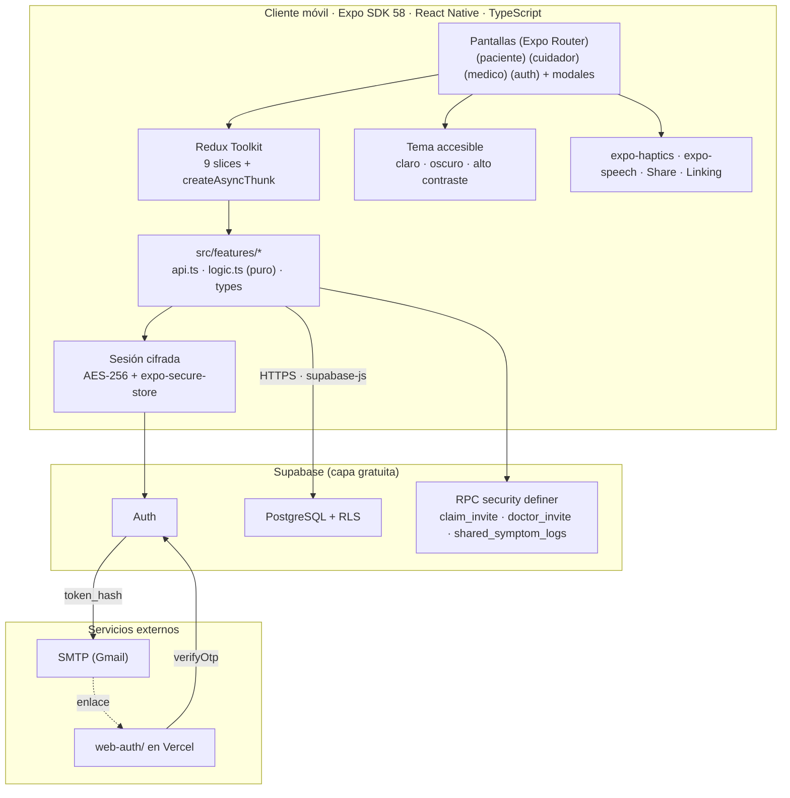
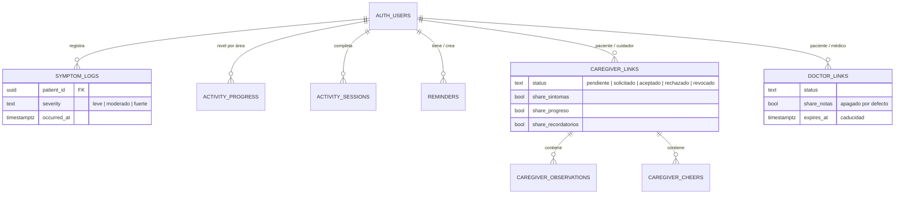

# Neurotrack EM — Documento Técnico Final (Fase 3)

**Una aplicación móvil para el seguimiento, la rehabilitación y el acompañamiento de personas con esclerosis múltiple**

| | |
|---|---|
| **Asignatura** | Desarrollo de Aplicaciones Móviles — Universidad de La Sabana, Facultad de Ingeniería |
| **Docente** | Santiago Rivadeneira Delgado |
| **Equipo** | Samuel Blanco · Amelyn Hofmann · Mariana Tirado |
| **Repositorio** | https://github.com/SamuelBlanco-65/NEUROTRACK_EM |
| **Fecha** | Noviembre de 2026 |

> Este documento consolida la propuesta del equipo (Fases 1 y 2, `docs/enunciado/NEUROTRACK_EM - FUENTE DE VERDAD.pdf`,
> citada como «la propuesta» y por sección, p. ej. §IV-C) con el producto construido. Cada afirmación sobre el software
> remite a un archivo del repositorio o a una evidencia en `artifacts/`; cuando solo hay confirmación verbal del equipo o
> auditoría de código, se dice.

---

## Sección 1 · Visión del producto, problema y estado del arte

### 1.1 Resumen ejecutivo y propuesta de valor

**Nombre:** Neurotrack EM · **Tagline:** *«Tu evolución, tu proceso, tu camino.»*

**Propósito.** Complementar —no reemplazar— el seguimiento médico de la esclerosis múltiple (EM) entre consultas: el
paciente registra síntomas, hace actividades de estimulación cognitiva y motriz y ve su evolución; su cuidador y, de forma
opcional, su médico tratante participan siempre con el consentimiento del paciente. **UVP:** un acompañamiento integral,
simple y humano que reúne síntomas, cognición, rehabilitación, apoyo emocional y cuidador «sin quitarle el protagonismo al
médico tratante» (§IV-B). La app no diagnostica, no genera alertas clínicas y no usa sensores (§IV-C).

| Perfil | Necesidad principal | Necesidades de accesibilidad que condicionan el diseño |
|---|---|---|
| **Paciente con EM** | Registrar cómo se siente, estimularse y llevar información útil a la consulta | Fatiga; alteración cognitiva (~41 % [1]); temblor; neuritis óptica con secuelas de contraste, color y fotofobia; posible baja visión o ceguera |
| **Cuidador, familiar o pareja** | Acompañar sin invadir, anotar lo que observa, recordar medicación y citas | Carga de cuidado significativa [2]; uso en momentos cortos y con atención dividida |
| **Médico tratante** (opcional) | Ver un resumen y comparar el mes actual con los anteriores | Lectura rápida; información que no se confunda con un diagnóstico |

### 1.2 Problema y análisis competitivo actualizado

La EM es muy variable y los controles médicos no permiten un monitoreo continuo; entre consultas, pacientes y cuidadores
quedan sin acompañamiento (§II-A). Las apps de salud móvil muestran beneficios pequeños a moderados en cognición y
fatiga, con evidencia aún limitada [3].

**Tabla 1.** Competidores de la Fase 1 y cómo responde el producto final.

| Herramienta | Brecha identificada (Fase 1) | Cómo la cubre Neurotrack EM (implementado) |
|---|---|---|
| **My MS Manager** | Solo registro; sin rehabilitación ni cuidador | Calendario de síntomas **más** actividades de memoria, atención y movimiento y módulo de cuidador con permisos (RF-001..006) |
| **Floodlight MS** | Casi puramente clínica; sin cuidador; desuso | Sin sensores (RT-003); tono de acompañamiento; apoyo con líneas de ayuda reales (RF-009) |
| **MSCopilot** | Demasiado texto, fatiga; ignora a la familia | Una acción principal por pantalla, instrucciones de una frase, sin cronómetro (RNF-008, RNF-010) |
| **MyTherapy** | Genérico, no para EM; sin cuidador ni apoyo | Recordatorios creados por el cuidador con alternativa visual y háptica (RF-008); apoyo por perfil |
| *Transversal* | Inglés/francés, sistemas de salud ajenos | Interfaz en español; Línea 106 y Emergencias 123 de Colombia (RNF-011) |

### 1.3 Innovación lograda frente al estado del arte

1. **Tres perfiles con permisos que controla el paciente.** El control no está en la interfaz sino en la base de datos
   (Row Level Security [12]); ningún competidor combina los tres perfiles (§IV-B).
2. **Cuidador activo:** observaciones privadas, recordatorios, mensajes de ánimo y lectura de lo que el paciente autorizó.
3. **Médico con información, no con alertas:** compara períodos con diferencias neutras («3 días más que el mes anterior») e
   indica la constancia de registro, para no confundir un día sin registro con uno sin síntomas. Es de solo lectura y su
   acceso caduca (D-016).
4. **Estimulación sin presión:** Memoria, atención y lógica suben de nivel por precisión (2 de 3 rondas), nunca por velocidad (§V-B).
5. **Accesibilidad como requisito de dominio:** tipografía Atkinson Hyperlegible, `lineHeight` escalado, modo de bajo
   brillo, severidad con forma y palabra, háptica, dictado y lectura en voz alta (Sección 3).

---

## Sección 2 · Arquitectura de software móvil e implementación técnica

### 2.1 Diagrama de arquitectura end-to-end



**Figura 1.** Topología. La app nunca usa la clave `service_role`: solo la clave pública; la seguridad la imponen las
políticas RLS y las funciones del servidor.

### 2.2 Decisiones arquitectónicas y estructura de componentes

**Tabla 2.** Decisiones principales (detalle en `docs/DECISIONES.md`).

| Decisión | Razón | Ref. |
|---|---|---|
| Expo + Expo Router | Stack exigido; navegación por grupos de perfil | D-001 |
| Supabase (Auth + Postgres + RLS) | Sincronización real (el enunciado prohíbe *mocks*) y permisos por fila para «acceso con autorización» | D-002 |
| Redux Toolkit | Estado compartido (sesión, perfil, vínculos, borradores) y asincronía con `createAsyncThunk` | D-005 |
| Vinculación por código corto | Sin cámara ni *deep linking*; el reclamo lo hace una función del servidor | D-010, D-016 |
| Médico en tabla propia, solo lectura | Las políticas del cuidador permiten escribir; un `role` compartido se lo habría dado al médico | D-016 |

**Organización modular.** Cada módulo de `src/features/` separa `api.ts` (acceso a Supabase y errores traducidos a
español), `logic.ts` (reglas puras, con pruebas) y componentes propios. Las pantallas (`src/app/`) no llaman a Supabase:
despachan *thunks* y leen del store. Reparto para la defensa: `auth`, `symptoms`, `legal`, `lib/supabase` — Samuel;
`caregiver`, `reminders`, `support` — Amelyn; `activities`, `progress` — Mariana; `doctor`, `audio`, `settings` — extensiones
del equipo.

**Navegación.** `src/app/index.tsx` es un *radiogroup* de tres perfiles; sin sesión redirige a `(auth)/acceder` y con sesión
al inicio del perfil (`PROFILE_HOME`). Paciente y cuidador usan pestañas nativas (`NativeTabs`: inicio, calendario o
acompañar, actividades u observaciones, progreso o recordatorios, apoyo); el médico, una pila sin pestañas porque solo
consulta. El asistente de síntomas y las actividades son modales.

**Estado asíncrono.** Cada llamada remota es un `createAsyncThunk` con estados `idle | cargando | listo | error` que se
traducen a `ScreenState`. Los errores se tipan por clase (`sin-conexion`, `servidor`, `validacion`, `codigo-invalido`): un
`TypeError` de red se muestra como «Revisa tu conexión e inténtalo de nuevo». El resumen del médico guarda el `requestId` y
descarta respuestas de un período anterior.

**Sesión segura.** `expo-secure-store` limita cada valor a ~2 KB en Android y el JWT de Supabase lo supera, así que la sesión
no sobrevivía a un reinicio. Se implementó `LargeSecureStore`: una clave AES-256 aleatoria en SecureStore y la sesión cifrada
en AsyncStorage (`src/lib/supabase.ts`). Al cerrar sesión, `resetAll` descarta los datos de salud de la memoria.

**Rendimiento.** Las listas son acotadas (registros de un mes, tres áreas, pocos vínculos), por lo que se usa `ScrollView`;
los cálculos derivados son funciones puras con `useMemo` y se piden al servidor solo los rangos necesarios. `FlatList`
queda en el *roadmap* para historiales largos.

### 2.3 Modelo de datos y contratos de servicio



**Figura 2.** Esquema relacional (10 migraciones en `supabase/migrations/`; atributos omitidos salvo los de permisos).
Todas las tablas referencian `auth.users` con `on delete cascade`: eliminar la cuenta borra todo (`delete_my_account`).

**Tabla 3.** Contratos de acceso (RLS y RPC).

| Recurso | Paciente | Cuidador (vínculo aceptado) | Médico (aceptado y vigente) |
|---|---|---|---|
| `symptom_logs` | Todo lo suyo | Vía `shared_symptom_logs`, sin notas, si `share_sintomas` | Vía `shared_symptom_logs`; notas solo si `share_notas` |
| `activity_progress`, `activity_sessions` | Todo lo suyo | Lectura si `share_progreso` | Lectura si `share_progreso` |
| `reminders` | Todo lo suyo | Crear y marcar «hecho» si `share_recordatorios` | — |
| `caregiver_observations` | **No las ve** | Las suyas | — |
| Vínculos | Crear, aceptar, rechazar, revocar | Reclamar código (`claim_invite`) | Reclamar código; no modifica el vínculo |

**Flujo de vinculación (RF-012, REC-003).** El paciente crea una invitación (código de 6 u 8 caracteres) y la comparte fuera
de la app; el otro perfil la reclama con `claim_*_invite` (límite de 10 fallos cada 15 min) y queda «solicitado», con la
identidad tomada de la sesión; el paciente acepta eligiendo permisos (y caducidad, si es médico) y puede revocar en cualquier
momento, con corte inmediato en el servidor. **Flujo de síntoma:** asistente de 3 pasos → borrador en `symptoms-slice` →
`createSymptomLog` con el reloj del dispositivo → el calendario invalida el mes y lo vuelve a pedir.

---

## Sección 3 · Implementación y auditoría de accesibilidad móvil

La propuesta de la Fase 2 (§V) se basa en WCAG 2.2 nivel AA [8] y los principios POUR; su justificación es clínica: la
neuritis óptica afecta hasta al 70 % de los pacientes (§V-D1) y la alteración cognitiva a ~41 % [1], [4], [7].

### 3.1 Semántica para lectores de pantalla (TalkBack)

- **Propiedades nativas en todos los controles:** `accessibilityRole` en 203 lugares, `accessibilityLabel` en 167,
  `accessibilityState` (seleccionado, marcado, deshabilitado, ocupado) y `accessibilityHint` cuando la acción no es obvia
  (conteo con `grep` sobre `src/`). Roles con significado: `radiogroup`/`radio` (perfil, severidad, período), `switch`
  (permisos), `header`, `alert` y `progressbar`.
- **Agrupamiento contra focos fragmentados:** tarjetas y filas son un solo elemento `accessible` con etiqueta completa. Cada
  permiso de «Mi médico» es un `Pressable` con rol `switch`, y el `Switch` visual se oculta al lector
  (`importantForAccessibility="no-hide-descendants"`) para que no se anuncie dos veces (`src/app/mi-medico.tsx`).
- **Cambios dinámicos:** `accessibilityLiveRegion` en 33 lugares (carga, errores de campo, cambio de período, código nuevo).
- **`testID`** estables en los 297 controles interactivos, usados en la verificación en emulador.

### 3.2 Diseño visual, contraste y tipografía adaptativa

- **Contraste verificado por script** (`scripts/validar-paleta.mjs`, ejecutable con `node`): calcula la fórmula de WCAG sobre
  18 pares texto/fondo y de ícono/borde, en el esquema claro y en el oscuro, y todos cumplen (mínimo 4,5:1 en texto y 3:1 en
  íconos y bordes). Ejemplos: texto principal 16,3:1 (claro) y 14,2:1 (oscuro); texto sobre botón principal 11,1:1 y 6,7:1.
  La auditoría de código había encontrado dos defectos reales —roles `onSecondaryFixed` sobre `secondaryContainer`
  (1,00–1,82:1 en oscuro) y el texto de los botones principales sobre `primaryContainer` en oscuro (~1,1:1)—, ya corregidos
  (los botones usan ahora `primary`).
- **`lineHeight` sin recorte:** React Native escala `fontSize` con la preferencia del sistema pero no un `lineHeight` fijo, lo
  que recortaba texto con fuente grande. `ThemedText` lo escala a mano (`src/components/themed-text.tsx`):

```tsx
const scaledLineHeight = lineHeight ? lineHeight * appTextScale * PixelRatio.getFontScale() : undefined;
```

- **Tipografía:** Atkinson Hyperlegible Next, diseñada para baja visión, con jerarquía fija (28/24/20 en títulos y 19/17/15 en
  cuerpo).
- **Nunca solo color (§V-D3):** la severidad usa tres barras (llenas o con contorno) y la palabra «Leve/Moderado/Fuerte»; las
  actividades, ícono ✓/✕ y texto; los permisos, «Sí/No»; las comparaciones, flechas y texto. **Daltonismo:** el mismo script
  simula protanopia, deuteranopia y tritanopia (matrices de Machado et al., severidad 1,0) y mide la diferencia de color CIE76
  (ΔE) entre los colores de estado. El par acierto/error queda en ΔE ≥ 23 en las tres simulaciones (≥ 40 en el esquema claro),
  y la severidad frente al fondo en ΔE ≥ 70. La única pareja bajo ΔE 15 es primario/secundario en oscuro con protanopia
  (11) y deuteranopia (14); no se usa como señal única: el estado «seleccionado» se anuncia con `accessibilityState` y cambia
  además el relleno, de alto contraste (8,8:1).
- **Bajo brillo (§V-D4):** esquema oscuro sin blanco ni negro puros; la apariencia (claro, oscuro, automático) se elige en la
  app, independiente del sistema, además de alto contraste y «Reducir animaciones» (`src/app/accesibilidad.tsx`).

### 3.3 Ergonomía táctil y navegación

- **Área táctil:** `MinTouchSize = 48` dp en todos los botones; los íconos de 32 dp llevan `hitSlop={8}` (40 usos) y los
  botones principales miden 56 dp.
- **Sin gestos complejos ni tiempo límite:** todo son toques simples; Memoria y atención no tienen cronómetro (§V-C).
- **Retroalimentación multicanal:** `expo-haptics` en las tres actividades y al marcar un recordatorio; mensajes visibles de
  éxito y error; `ActivityIndicator` y `accessibilityState={{ busy }}` durante la carga.

### 3.4 Matriz trazable: propuesta del Corte 2 frente a implementación final

**Tabla 4.** **V** = verificado con prueba, script o captura; **C** = auditoría de código o confirmación del equipo, sin
captura.

| # | Mejora prometida (§) | Implementación | Validación | Est. |
|---|---|---|---|---|
| 1 | Alternativa visual y háptica a alertas sonoras (§V-A) | `(paciente)/inicio.tsx`, `actividad/[area].tsx` | Captura `artifacts/t4/t4-nuevo-recordatorio.png` | V |
| 2 | Transcripción/subtítulos (§V-A) | `features/support/constants.ts`, `apoyo/[id].tsx` | Captura `artifacts/t5/paciente-apoyo-detalle-audio.png` | V |
| 3 | `accessibilityLiveRegion` (§V-A) | `screen-state.tsx`, `text-field.tsx`, `progreso.tsx` | Auditoría `accessibility-reviewer` | C |
| 4 | Instrucciones cortas, pasos simples (§V-B) | `registrar-sintoma/paso-1..3.tsx`, `InstructionCard` | Capturas `artifacts/t1/wizard-paso*.png` | V |
| 5 | Dificultad progresiva sin velocidad (§V-B) | `activities/logic.ts` | 11 pruebas Jest | V |
| 6 | Áreas táctiles amplias (§V-C) | `MinTouchSize`, `hitSlop` | Auditoría; 2 excepciones corregidas | C |
| 7 | Texto escalable sin recortes (§V-D2) | `themed-text.tsx` | Auditoría (defecto corregido) | C |
| 8 | Un elemento principal por pantalla (§V-D2) | Patrón título + 1 acción + `ScreenState` | Auditoría de código | C |
| 9 | Color + ícono + texto, sin rojo-verde (§V-D3) | `calendario.tsx`, `severity-bars.tsx`, `ShapeButton` | Captura `artifacts/t1/calendario-dia-con-registros.png` | V |
| 10 | Paleta validada en los tres tipos de daltonismo (§V-D3) | `src/theme/colors.ts` | `scripts/validar-paleta.mjs` sobre la paleta final | V |
| 11 | Bajo brillo, sin blanco puro (§V-D4) | `DarkColors`, `accesibilidad.tsx` | Contraste por script (18 pares) y capturas en oscuro `artifacts/t11/01`, `02`, `05`, `07` | V |
| 12 | Apariencia independiente del sistema (§V-D4) | `features/settings/persistence.ts` | Prueba del equipo en emulador | C |
| 13 | Lector de pantalla, etiquetas, orden lógico (§V-D5) | `accessibility*` en `src/app/**`, `src/components/**` | Auditoría y 14 capturas con TalkBack en celular (`artifacts/talkback/`, 4.3) | V |
| 14 | Dictado para síntomas (§V-D5) | `features/audio/dictation-button.tsx` | Captura del micrófono del teclado escribiendo la nota: `artifacts/talkback/08`, `10` | V |
| 15 | Versión auditiva (§V-D5, extensión) | `expo-speech`, «Lectura en voz alta» | 32 pruebas Jest; confirmado en celular | C |

---

## Sección 4 · Pruebas funcionales, rendimiento y validación de usuario

### 4.1 Pruebas automatizadas

124 pruebas con Jest (`jest-expo`) en 12 suites, todas en verde (`npm test`), sobre la lógica de dominio y sin UI: perfil del
médico (27), lectura en voz alta (34), progreso (14), actividades (22, incluida la lógica), términos y privacidad (7), calendario y resumen de
síntomas (9), validación de acceso (8) y contenido «no diagnostica» (3). `tsc --noEmit` y ESLint pasan sin errores.

### 4.2 Casos de prueba ejecutados en dispositivo

Ejecutados contra Supabase real, en emulador Android (automatizado con `adb` en T0–T1) o en celular con Expo Go.

**Tabla 5.**

| # | Caso | Tipo | Resultado | Evidencia |
|---|---|---|---|---|
| 1 | Registro, aviso de confirmación e inicio de sesión | Happy path | OK | `artifacts/t05/t05-acceder-registro.png` |
| 2 | Inicio con correo sin confirmar | Error | Mensaje traducido con ícono | `artifacts/t05/t05-acceder-error-correo-no-confirmado.png` |
| 3 | Validación de campos | Validación | Borde, ícono y texto | `artifacts/t05/t05-acceder-validacion-cliente.png` |
| 4 | Sesión persiste tras reiniciar | Persistencia | OK | STATUS T0.5 |
| 5 | Registrar síntoma en 3 pasos | Happy path | Aparece en el calendario | `artifacts/t1/` |
| 6 | Memoria, Atención, Lógica y Movimiento hasta completar | Happy path | Sube de nivel; resumen | Confirmado por el usuario; `artifacts/t2/`; Lógica en `artifacts/t11/04`–`06` |
| 7 | Progreso: semana, mes, 3 meses | Happy path | Insights y datos insuficientes | `artifacts/t3/`; barras seleccionables y semana con datos en `artifacts/t11/03`, `09` |
| 8 | Vínculo paciente–cuidador con dos cuentas | Permisos | El cuidador ve solo lo autorizado | `artifacts/t4/Inicio_cuidador.png`, `t4-acompar.png` |
| 9 | Observación privada y recordatorio «hecho» | Happy path | OK con háptica | `artifacts/t4/t4-observaciones.png` |
| 10 | Apoyo: llamada de crisis y guía con transcripción | Happy path | OK en ambos perfiles | `artifacts/t5/` |
| 11 | Confirmar correo y recuperar contraseña | Happy path | OK | Confirmación del equipo |
| 12 | Perfil médico con dos cuentas: vincular, aceptar, resumen, revocar | Permisos | OK | Confirmación del equipo; sin capturas guardadas |
| 13 | Errores de red | Error | «Revisa tu conexión» por clase de error | Revisión de código |

**Defectos hallados solo al probar en dispositivo:** la «sesión» se armaba con `data.user` y no `data.session` (un registro sin
confirmar parecía autenticado); SecureStore fallaba en silencio por el límite de 2 KB; Atención salía en blanco por la fase
inicial; los errores de Supabase caían en un mensaje genérico porque `instanceof PostgrestError` nunca era verdadero; el error
del registro no se mostraba; las pestañas nativas no heredaban el tema; los banners `tertiaryFixed` quedaban ilegibles en
oscuro; las barras del gráfico de Progreso no se podían seleccionar con TalkBack; y, tras cerrar sesión y entrar con otra
cuenta, Actividades mostraba «No hay sesión activa» porque la pestaña pedía datos antes de tener sesión. Los nueve están
corregidos (`docs/STATUS.md`).

### 4.3 Auditoría de accesibilidad en dispositivo y en código

| Auditoría | Herramienta | Resultado |
|---|---|---|
| Código completo (2026-11-09) | `accessibility-reviewer`: propiedades y contraste WCAG | 2 defectos reales corregidos (`lineHeight`; contraste en oscuro) y 2 áreas táctiles bajo el mínimo |
| Perfil médico (2026-11-11) | `accessibility-reviewer` | Filas de permiso fragmentadas, controles a 40 dp, etiquetas repetidas: corregido |
| Seguridad del perfil médico | `security-reviewer` | Oráculo de códigos, límite no atómico, columnas escribibles: corregido antes de la migración |
| Contraste y daltonismo (2026-11-11) | `scripts/validar-paleta.mjs` | 18 pares sobre mínimo en ambos esquemas; estados distinguibles en protanopia, deuteranopia y tritanopia |
| Lector de pantalla | TalkBack en celular Android real (2026-11-11, modo oscuro) | 14 capturas con el foco del lector en `artifacts/talkback/` (nota en su `README.md`): selección de perfil, acceso, inicio, asistente de síntomas con dictado, calendario, actividades, accesibilidad y progreso, en el perfil paciente. Con TalkBack activo la voz de la app cede la prioridad a TalkBack (correcto). Con TalkBack se halló y corrigió que las barras del gráfico de Progreso no eran seleccionables |

---

## Sección 5 · Conclusiones, limitaciones y trabajo futuro

### 5.1 Alcance logrado y lecciones aprendidas

Se construyó el MVP comprometido en §IV-C —síntomas y calendario, actividades cognitivas y motriz progresivas, módulo del
cuidador con consentimiento, historial y comparación, espacio de apoyo y cuentas sincronizadas— y tres extensiones que la
propuesta dejaba como opcionales: dictado, lectura en voz alta y perfil del médico. De 39 requisitos trazados
(`docs/REQUISITOS.md`), 35 están verificados con evidencia, 1 implementado sin probar (el README, que falta seguir desde cero en un equipo
limpio) y 3 pendientes, que son entregables de la entrega misma (demo en vivo, defensa individual y equidad de commits).

**Lecciones.** (1) Probar en dispositivo encuentra defectos que el código no muestra: los nueve de la sección 4.2. (2) La
seguridad vive en el servidor: RLS filtra filas pero no columnas, y dejar que el cliente elija el código de invitación abre
un oráculo para adivinarlo. (3) La accesibilidad requiere método: calcular el contraste en ambos esquemas y automatizarlo
evitó que el defecto de los botones en oscuro siguiera sin verse. (4) Mantener la lógica pura fuera de la UI hizo posibles
las 124 pruebas. (5) El diseño generado con IA se filtra: del perfil médico de Stitch se adoptaron unos diez elementos y se
descartaron los que inventaban datos que la app no recoge (edad, diagnóstico, «nivel de energía»), el tono clínico, uno que
mostraba al médico las notas privadas del cuidador y afirmaciones falsas («cifrado de extremo a extremo»).

### 5.2 Limitaciones conocidas

1. **Solo Android:** verificado en emulador y Expo Go; sin iOS.
2. **Evidencia de accesibilidad en dispositivo parcial:** las capturas de TalkBack cubren el perfil paciente, no cuidador
   ni médico; no hay capturas con la fuente del sistema ampliada.
3. **Vinculación del cuidador:** el código lo genera el cliente y el límite de intentos no es atómico; ya se corrigió en el
   médico (D-016).
4. **Sin caché offline:** sin conexión la app muestra un error claro pero no trabaja con datos locales; los recordatorios
   no usan notificaciones del sistema, solo alerta visual y háptica dentro de la app.
5. **Fuera de alcance a propósito:** la verificación del registro profesional del médico, la
   validación clínica y los sensores (§IV-C); el modo oscuro y alto contraste existen, pero no un control de brillo propio.
6. **Autoría en Git:** el trabajo conjunto se registró con `Co-Authored-By` (D-007).

### 5.3 *Roadmap*

| Versión | Contenido |
|---|---|
| 1.1 | Código de invitación del cuidador generado en el servidor con límite atómico; recorrido TalkBack completo |
| 1.2 | Caché offline con cola de sincronización; notificaciones locales para recordatorios; `FlatList` para historiales largos |
| 2.0 | Versión auditiva completa de las actividades; verificación de profesionales; publicación en Google Play con EAS |

---

## Referencias

[1] M. Askari *et al.*, "Prevalence of cognitive impairment (CI) in patients with multiple sclerosis (MS): A systematic
review and meta-analysis," *Caspian Journal of Internal Medicine*, vol. 15, n.º 3, pp. 392–413, 2024, doi: 10.22088/cjim.15.3.392.

[2] G. Giusto *et al.*, "Digital psychosocial tools and interventions for supporting informal caregivers of people with
multiple sclerosis: A systematic review," *Multiple Sclerosis and Related Disorders*, vol. 105, p. 106876, 2026,
doi: 10.1016/j.msard.2025.106876.

[3] C. Heesen *et al.*, "Mobile health interventions in multiple sclerosis: A systematic review," *Journal of Neurology,
Neurosurgery & Psychiatry*, 2023.

[4] K. Lugosi *et al.*, "Domain-specific cognitive impairment in multiple sclerosis: A systematic review and meta-analysis,"
*Annals of Clinical and Translational Neurology*, vol. 11, n.º 3, pp. 564–576, 2024, doi: 10.1002/acn3.51976.

[5] Organización Mundial de la Salud, *Global Report on Health Equity for Persons with Disabilities*. Ginebra: OMS, 2023.

[6] M. Roheger *et al.*, "A systematic review and meta-analysis of socio-cognitive impairments in multiple sclerosis,"
*Scientific Reports*, vol. 14, p. 7096, 2024, doi: 10.1038/s41598-024-53750-5.

[7] W. Wu *et al.*, "The prevalence of cognitive impairment in relapsing-remitting multiple sclerosis: A systematic review
and meta-analysis," *Neuropsychology Review*, vol. 35, pp. 233–253, 2024, doi: 10.1007/s11065-024-09640-8.

[8] World Wide Web Consortium (W3C), "Web Content Accessibility Guidelines (WCAG) 2.2," W3C Recommendation, 2023. [En línea].
Disponible en: https://www.w3.org/TR/WCAG22/

[9] Congreso de la República de Colombia, Ley Estatutaria 1618 de 2013, 2013.

[10] Congreso de la República de Colombia, Ley Estatutaria 1581 de 2012, «por la cual se dictan disposiciones generales para
la protección de datos personales», 2012.

[11] Meta Platforms, "Accessibility," React Native documentation. [En línea]. Disponible en: https://reactnative.dev/docs/accessibility

[12] Supabase, "Row Level Security," Supabase documentation. [En línea]. Disponible en:
https://supabase.com/docs/guides/database/postgres/row-level-security
